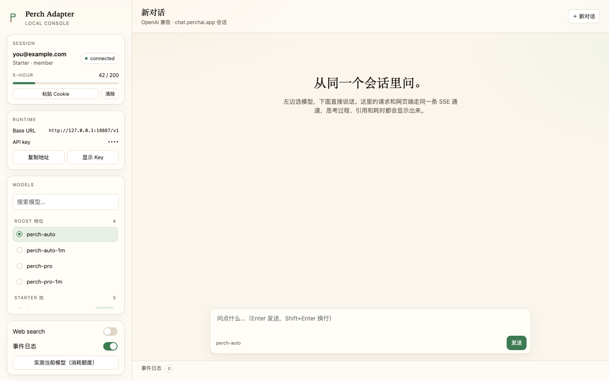

# perchai-openai-adapter

把 [chat.perchai.app](https://chat.perchai.app) 的网页会话包成 OpenAI 兼容接口。
不需要安装 Perch Desktop，只要一个已登录的 Web 会话。

> 非官方项目，与 Perch AI 无关联。使用前请阅读 [免责声明](DISCLAIMER.md)；
> 源代码采用 [MIT License](LICENSE)。

## Starter 桌面模型：直接实现 CLI 请求协议

适配器不再启动 `perchai-cli` 子进程，而是直接实现它的 turn 协议
（从 `perchai-cli@2.4.115` 的 `dist/perch.mjs` 逆向，见 `reports/cli-protocol.md`）。
不安装或启动 Perch Desktop，不要求再次登录：沿用已导入 Cookie 的 Supabase 会话。
首次安装依赖运行 `npm ci --ignore-scripts`；运行环境需要 Node.js 22.13+。

- 路由：`laguna-s`、`deepseek-flash-starter`、`glm-5.3-flash-starter`、
  `minimax-m3.1-flash-starter` → CLI 协议（`/api/perch-terminal/*`）；普通 `perch-auto` → 原 Web 接口。
- 每轮先 `POST /api/perch-terminal/turn-ticket`（`surface: "cli"`、`profile: "standard"`）拿签名票据，
  再带 `x-perch-turn-ticket` 调 `POST /api/perch-terminal/model-call`，SSE 返回
  `reasoning_delta` / `answer_delta` / `done`。票据由上游签发并绑定 surface，不能伪造或跨通道复用。
- 请求里固定 `clientSurface: "cli"`、`strictManual: true` 和 `manualModelOptionId`；
  `done.model` 与所选模型不一致时本轮判失败，不会静默回退到别的模型。
- 流模式现在是真正的增量输出：控制台和 OpenAI `stream: true` 都会边生成边收到内容。
  Web Search 暂不支持这条通道，开启时会明确报错。
- 请求只带本适配器自己的简短系统提示和对话历史，不再加载官方 Agent 的完整系统上下文；
  短请求的输入 token 从约 1–1.5 万降到几十。用量显示上游 `done.usage` 的真实统计。
- 切换 Web / CLI 通道会新建独立对话。CLI 同通道历史保存在 `data/cli-history/`（0600），
  按账号和线程隔离；历史在本地拼成消息后随每轮请求发送。

真实测试（会消耗当前账号额度）：

```bash
npm run probe:desktop -- glm-5.3-flash-starter
```

测试通过本地控制台 HTTP 接口执行，结果保存到 `reports/desktop-live-test.json`。
早期手写请求被 `perch_surface_required` 拒绝，原因是缺少 CLI 的 `clientSurface`/
票据头（而不是票据本身不可用）；现在的实现完整复刻了官方 CLI 的三步协议，
不伪造票据、不绕过拒绝，也不会把失败请求重发为其他模型。

## 先说结论

- Perch Web 自己就是完整的模型客户端：浏览器直接 `POST /api/perchai/chat`，服务端用 SSE 把
  `answer_delta` / `reasoning_delta` / `citations` 推回来。Desktop 只是另一个 surface，不是模型网关。
- 登录是 Supabase（`zlfuvsfjtgsdtqcaykia.supabase.co`），会话放在 cookie
  `sb-zlfuvsfjtgsdtqcaykia-auth-token[.0|.1]` 里，值是 `base64-` + base64url(JSON session)。
- 模型选择通过 `manualModelOptionId` 传给服务端；Roost 档位用 `roostChoice` =
  `standard | standard_max | pro | pro_max`。本仓库从 bundle 还原了 44 个具名模型 ID。
- 套餐限制在**服务端**：Starter 只能用自己的 Roost/Starter 池，具名模型要 Pro；
  服务端错误文案还明确写了“Perch-hosted models for Web / Desktop / CLI only，
  不含 direct API access”。所以这里的定位是“让你的 Web 会话可以在别的客户端里用”，
  不是绕过套餐，也不适合拿去做对外 API 转售。

## 快速开始

```bash
cd perchai-openai-adapter

# 方式 A：手动贴 Cookie（最快）。从剪贴板读，不落 shell 历史
pbpaste | npm run session

# 方式 B：一次性浏览器登录。会开一个独立的 Chrome profile，手动完成 Google/GitHub 登录
npm run login

# 方式 C：不改文件，直接用环境变量
PERCHAI_COOKIE='sb-zlfuvsfjtgsdtqcaykia-auth-token.0=...; sb-zlfuvsfjtgsdtqcaykia-auth-token.1=...' npm start

# 自检：账号信息 + 真实发一轮 SSE
npm run probe
# 指定模型 / 开联网检索
npm run probe -- --model gpt-6-sol --web-search --prompt "用一句话介绍你自己"

npm start
```

`npm run session` 会先本地解出 `access_token` 的 claims，再调 `/api/perchai/account`
校验，成功后打印并保存：

```
session: 解出 access_token · you@example.com
邮箱     you@example.com
套餐     Starter (starter)
角色     member
用量     {"used":42,"limit":200,"period":"5-hour"}
过期     还有 58 分钟（会自动刷新）
已保存到 data/state.json
```

Cookie 从哪来：登录 chat.perchai.app 后，DevTools → Application → Cookies →
`chat.perchai.app`，复制 `sb-zlfuvsfjtgsdtqcaykia-auth-token.0` 和 `.1` 两行；
或者 Network 里任意 `/api/perchai/*` 请求，整行 `Cookie` 复制。
只贴 `base64-` 开头的值也可以，adapter 会自己补名字并拼分片。

启动后：

| 地址 | 用途 |
| --- | --- |
| `http://127.0.0.1:18791/console` | 本地控制台（会话、模型、对话、实测） |
| `http://127.0.0.1:18791/v1` | OpenAI base URL |
| `http://127.0.0.1:18791/v1/models` | 模型列表 |
| `http://127.0.0.1:18791/healthz` | 健康检查（不需要 key） |

### 控制台



打开 `/console` 后可以做这些事：

- 看当前会话：邮箱、套餐、角色、5 小时/月度用量条。
- 号池：列出所有账号，标出邮箱/套餐/冷却状态；点账号可把对话固定到它，点「自动分配」交回策略。
- 会话卡上的「粘贴 Cookie」：贴进去 → 识别并保存，页面立刻刷新成新账号。
- 选模型：Roost 四档、Starter 池、具名模型分组，支持搜索；选中后 composer 会显示实际下发的
  `manualModelOptionId`。
- 窄屏也能选：输入框左侧常驻模型下拉，右上角「☰ 模型」打开侧栏抽屉；选中任意一行会同步两边。
- 套餐提示：从 `session.entitlements` 读 `models.manual_select` 与 `limits.allowed_models`，
  直接告诉你当前账号是否允许手动选模型。
- 直接流式对话：思考过程折叠显示、引用 chip、模型/档位/耗时/"think" 耗时。
- 事件日志区域已移除。回复下方显示请求模型、返回模型、调用通道和可用的用量信息。
- 「实测当前模型」：新建线程发一句 `Reply with exactly: OK`，结果以 ✓/✗ 记在本地
  （`localStorage`），用来快速摸清套餐池。

控制台自身用一次性 HttpOnly cookie（`perch_console`）鉴权，API key 不写进页面源码，
点「显示 Key」才按需取。默认只监听 `127.0.0.1`。

API key：`PERCHAI_ADAPTER_KEY`，没设就首次启动随机生成并写到 `data/state.json`（0600），
启动时会打印。

OpenAI SDK 用法：

```python
from openai import OpenAI

client = OpenAI(base_url="http://127.0.0.1:18791/v1", api_key="<启动时打印的 key>")
stream = client.chat.completions.create(
    model="perch-auto",           # 或 perch-pro / gpt-6-sol ...
    messages=[{"role": "user", "content": "你好"}],
    stream=True,
    extra_body={"user": "my-conversation-1", "web_search": True},
)
for chunk in stream:
    print(chunk.choices[0].delta.content or "", end="", flush=True)
```

`user` 用来标识一条对话：同一个 `user` 会复用同一个 Perch thread，保留上下文。
也可以直接传 `X-Perch-Thread: <threadId>` 指定已有线程，`X-Perch-Stateless: 1` 强制新建。

### 号池（多账号）

账号存在 `data/accounts.json`（0600），Cookie 只留在本地，控制台 API 只返回邮箱/套餐/状态。
第一次启动会把 `data/state.json` 里原有的 Cookie 自动迁移成 `default` 账号，旧的单账号用法不受影响。

添加账号的两种方式：

```bash
# 每个账号粘一次（会同时写回 state.json 兼容旧脚本，并加入号池）
pbpaste | npm run session
```

或打开 `/console` →「号池」→「＋ 添加账号」，粘贴 Cookie 并给个备注名（例如 `账号A`）。
同一个上游 `userId` 重复添加时只更新 Cookie 和备注，不会产生重复条目。

分配规则：

| 场景 | 选中账号 |
| --- | --- |
| 请求带 `X-Perch-Account: <id>` 或 `perch.account` | 强制用该账号；不存在/停用/冷却中会直接报错 |
| 同一 `user` 的后续轮次 | 沿用该对话已绑定的账号 |
| 新对话、自动模式 | 按策略挑：`round-robin`（默认）或 `least-recently-used` |

账号和对话是绑定的：同一个 `user` 会稳定落在同一账号；显式换账号时，适配器会发现线程属于另一个账号，
自动新建线程，避免把 A 的 threadId 发给 B。CLI 历史本来就按 `userId + threadId` 隔离，不受影响。
OpenAI 响应里的 `perch.account` 会告诉你这一轮实际用了谁；控制台的回复元信息也会显示「账号：…」。

冷却：账号返回 401/403 时冷却 5 分钟，返回 429 / `turn_rate_limited` 时冷却 60 秒；
自动分配会跳过冷却中的账号。显式指定冷却账号会返回 `account_cooldown`，不会偷偷换号。

管理接口（需要控制台 cookie，仅供本机使用）：

| 方法 | 路径 | 说明 |
| --- | --- | --- |
| `GET` | `/console/api/accounts` | 列出号池（不含 Cookie） |
| `POST` | `/console/api/accounts` | `{cookie,label}` 添加/更新账号 |
| `PATCH` | `/console/api/accounts` | `{id,label?,enabled?}` 改名或启停 |
| `DELETE` | `/console/api/accounts` | `{id}` 移除账号（不删上游） |
| `POST` | `/console/api/accounts/select` | `{id}` 设为当前账号 |
| `POST` | `/console/api/accounts/strategy` | `{strategy:"round-robin"\|"least-recently-used"}` |
| `POST` | `/console/api/accounts/test` | `{id}` 只调 `/api/perchai/account`，不消耗推理额度 |
| `POST` | `/console/api/accounts/refresh` | `{id}` 刷新 Supabase token 并回写号池 |

OpenAI 兼容调用里指定账号：

```bash
curl http://127.0.0.1:18791/v1/chat/completions \
  -H "Authorization: Bearer $KEY" -H "Content-Type: application/json" \
  -H "X-Perch-Account: acc_xxxxxxxx" \
  -d '{"model":"glm-5.3-flash-starter","user":"test-a","messages":[{"role":"user","content":"hi"}]}'
```

## 抓到的协议

证据来自 `chat.perchai.app` 的 Next.js/Turbopack bundle（见
`open-reverselab/cases/2026-10-perchai-chat`），关键代码在 `0r1se5z0~9hty.js`（聊天页）
和 `0.b3i2poxp9~k.js`（Supabase 客户端）。

| 接口 | 方法 | 说明 |
| --- | --- | --- |
| `/api/perchai/account` | GET | `{ok, profile, session:{planCode, planName, entitlements, membershipRole}, usageMeter}` |
| `/api/perchai/threads` | GET | `{ok, threads:[{id,title,updatedAt}]}` |
| `/api/perchai/threads?threadId=` | GET | `{ok, messages:[{id,role,text,citations,artifact,...}]}` |
| `/api/perchai/threads` | POST `{}` | 新建线程，`{ok, thread:{id}}` |
| `/api/perchai/threads` | PATCH | `{threadId, title}` 重命名 |
| `/api/perchai/chat` | POST | 发一轮，`Accept: text/event-stream` 返回 SSE |
| `/api/perchai/chat/stop` | POST | `{threadId}` 中断 |
| `/api/perchai/upload` | POST | 附件上传（本 adapter 暂不支持） |

`/api/perchai/chat` 请求体（Web 端原样）：

```json
{
  "message": "用户这轮的文字",
  "clientMessageId": "A-Za-z0-9_- 8~64 位",
  "threadId": "线程 id",
  "webSearch": false,
  "roostChoice": "standard",
  "manualModelOptionId": null,
  "promoOverflowAccepted": false
}
```

历史消息由服务端按 `threadId` 维护，客户端只发最新一轮。

SSE 事件（`data: {...}`，空行分隔）：

| type | 字段 | 含义 |
| --- | --- | --- |
| `reasoning_delta` | `text` | 思考过程增量 |
| `status` | `phase`, `query` | `searching` / `reading` / `document` |
| `citations` | `citations[]` | 引用来源 |
| `artifact` | `artifact` | 生成文档/代码等产物 |
| `answer_delta` | `text` | 正文增量 |
| `done` | `ok`, `text`, `stopped`, `messageId`, `modelLabel`, `tier`, `durationMs`, `thinkingMs`, `error`, `errorCode`, `limit` | 收尾；`ok:false` 时带错误码 |

本 adapter 把 `answer_delta` 映射成 `delta.content`，`reasoning_delta` 映射成
`delta.reasoning_content`，`done` 里的线程/档位/引用放在最后的 `perch` 字段里。

## 模型

| 模型 id | 上游参数 |
| --- | --- |
| `perch-auto` | `roostChoice: standard`（200K） |
| `perch-auto-1m` | `roostChoice: standard_max`（1M） |
| `perch-pro` | `roostChoice: pro`（200K） |
| `perch-pro-1m` | `roostChoice: pro_max`（1M） |
| 具名模型（44 个） | `manualModelOptionId: <provider>-<model>` |

具名模型清单在 `data/model-options.json`，例如：

| 名称 | manualModelOptionId |
| --- | --- |
| `gpt-6.1-sol` | `azure-foundry-gpt-6-1-sol` |
| `gpt-6-sol` | `azure-foundry-gpt-6-sol` |
| `claude-opus-5.5` | `snowflake-claude-opus-5-5` |
| `claude-sonnet-5.5` | `snowflake-claude-sonnet-5-5` |
| `gemini-4-argon` | `gemini-gemini-4-argon` |
| `glm-5.3` | `azure-foundry-fw-glm-5-3` |
| `kimi-3` | `azure-foundry-fw-kimi-k3` |
| `deepseek-v4.1-flash` | `dashscope-deepseek-v4-1-flash` |
| `qwen-3.8` | `wandb-qwen-qwen3-8-27b` |
| `grok-4.7` | `azure-foundry-grok-4-7` |

2026-10-24 实测修正：`pilot` / `demo` 在官方 Web 代码中属于 Starter。
`models.manual_select=true` 和 `limits.allowed_models=["*"]` 不能单独证明 Web Pro 权限；
官方 `canPerchaiWebManualSelect` 会优先排除 Starter。

一条真实 Pilot 请求发送 `manualModelOptionId=azure-foundry-fw-kimi-k3`、
`roostChoice=standard`，返回 `done.ok=true`、`modelLabel=MiniMax M3`、`tier=standard`。
因此 HTTP 成功不能证明指定模型生效，也不能仅凭模型的自我介绍判断身份。
本适配器按套餐和调用通道校验：Starter 桌面组走 CLI 协议，升级组拒绝发送，
Starter 请求 Pro 档位返回 `pro_tier_unavailable`。`perch-auto` 的底层模型由上游路由选择。
模型清单中的 Starter/Pro 分组只表示目录分类，不代表当前账号权限。

服务端拒绝时 `done.ok=false`，看 `errorCode`。常见值：

| errorCode / 文案 | 含义 |
| --- | --- |
| `not_authenticated` | 会话失效，重新 `npm run login` |
| `promo_overflow_decision` | 促销额度需要二次确认；adapter 会把它当错误返回 |
| `starterModel` / `starterTier` | 该模型不在你的套餐池里 |
| `turnRateLimited` / `modelRestricted` | 速率或套餐限流，稍后再试 |
| `surfaceRequired` | 上游判定不是 Web/Desktop/CLI 的正常调用 |

## 会话与刷新

- `npm run login` 用独立 profile（`data/browser-profile`）登录，成功后把 cookie 写进
  `data/state.json`（0600）。之后不再需要浏览器。
- adapter 会从 cookie 里解出 `refresh_token`，access token 快过期时自动调
  Supabase `/auth/v1/token?grant_type=refresh_token` 续期并回写 cookie。
- 想换账号：删掉 `data/state.json` 后重新 `npm run login`。

## 已知边界

- 附件/图片、语音转写、artifact 下载、Perch Terminal 的会话持久化（`cli-turn`）都没做。
  适配器只使用 `/api/perch-terminal/cli-context`、`/turn-ticket`、`/model-call` 三个端点。
- Web 通道通常不返回 token 用量；CLI 通道在控制台显示上游 `done.usage` 的用量。
- 每条 OpenAI 请求只有在“同一 `user` + 历史轮数匹配”时才复用 thread；
  历史对不上会新建 thread，并把之前的对话以文本形式回放一次。
- `system` / `developer` 消息会被拼到本轮 `message` 前面，Perch 自己的系统提示仍在其上。
- 本机 curl/Node 默认能直连 `chat.perchai.app`；如果走代理，注意 `Origin` / `Referer`
  需要保持站点本身。

## 验证

```bash
npm test                 # mock 上游，覆盖 cookie 解析、Web/CLI 两条 SSE、thread 复用、OpenAI 流/非流
npm start                # 另开一个终端；下面的真实测试需要适配器已在 18791 监听
npm run test:protocol -- stream glm-5.3-flash-starter   # 真实账号，消耗一次额度
npm run test:protocol -- nonstream glm-5.3-flash-starter
npm run test:protocol -- console glm-5.3-flash-starter
```

已通过：

- 匿名访问真实站点：`/api/perchai/account`、`/api/perchai/threads` 返回
  `401 {"ok":false,"error":"not_authenticated"}`，确认走 cookie 鉴权。
- mock 端到端：Web 与 CLI 两条通道的流式与非流式、`reasoning_content`、错误与 `[DONE]`、
  `x-perch-turn-ticket`/`clientSurface`/`strictManual` 校验、历史不匹配时新建线程均通过。
- 真实 CLI 协议：`glm-5.3-flash-starter` 的流式（`E2E-OK`）、非流式（`E2E-OK`）
  和控制台「实测当前模型」（`OK`，32 tokens）均通过，回执在 `reports/cli-protocol-live-test.json`。

`perchai-cli` 依赖仅作为协议参考与抓包基线保留，运行时不再加载或启动它。
上游对 turn ticket 有短窗口轮次限流：连续两次真实调用可能返回 `turn_rate_limited`，
稍等再试即可，适配器不会用旧票据绕过该限制。

## 许可证与免责声明

- 源代码：[MIT License](LICENSE)，版权归 `JamesYang`。
- 使用前请阅读：[DISCLAIMER.md](DISCLAIMER.md)。

本项目是非官方、本地运行的适配器，与 Perch AI 无隶属或背书关系。请使用自己的账号，
遵守上游服务条款、套餐与速率限制；不要用于绕过付费/限流、账号共享或对外 API 转售。
`data/` 下有 Cookie 与号池文件（`state.json`、`accounts.json`），已在 `.gitignore` 中排除，
开源或分享前请再确认没有把凭据带出去。MIT 许可只覆盖本仓库的源代码，不覆盖 Perch 的服务、
模型、商标、内容或第三方依赖。

真实账号的最后一跳需要你的会话：跑一次 `npm run login`，再 `npm run probe`。
